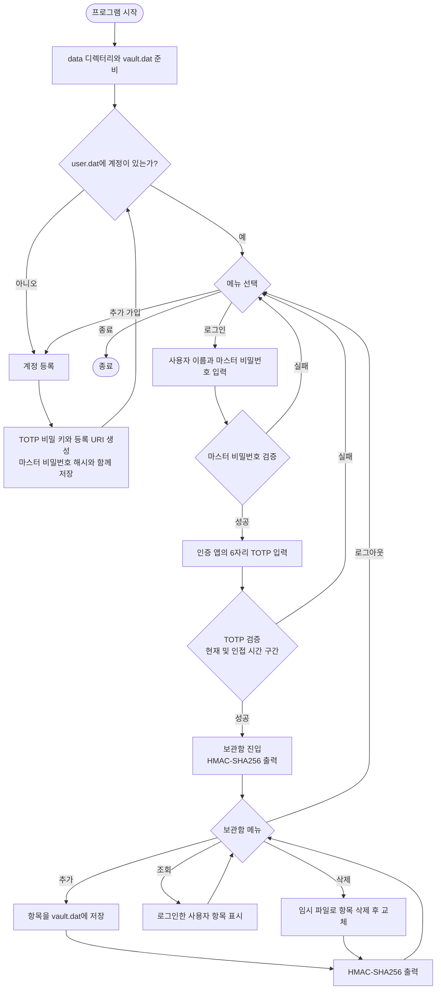

# 비밀번호 관리 프로그램 동작 메커니즘


이 문서는 프로그램이 시작된 뒤 계정 등록과 로그인, 비밀번호 보관함 사용까지 진행되는 과정을 설명합니다.


## 전체 흐름


```text

프로그램 시작

  -> data 디렉터리와 vault.dat 준비
  -> 계정이 없으면 가입, 있으면 로그인/추가 가입/종료 선택
  -> 마스터 비밀번호 확인
  -> TOTP 코드 확인
  -> 보관함 항목 추가·조회·삭제
  -> 로그아웃 후 메뉴로 복귀

```


### 흐름도




## 1. 프로그램 시작


`main()`은 `vault_initialize()`를 호출해 `data/` 디렉터리와 `data/vault.dat` 파일을 준비합니다. 그런 다음 `auth_user_exists()`로 `data/user.dat`에 계정 데이터가 있는지 확인합니다.


- 계정이 없으면 첫 계정을 등록하도록 안내합니다.

- 계정이 있으면 로그인, 다른 계정 등록, 종료 중 하나를 선택할 수 있습니다.


## 2. 계정 등록


1. 사용자 이름과 마스터 비밀번호를 입력합니다. 비밀번호 입력은 터미널에 문자가 그대로 보이지 않도록 처리합니다.
2. 비밀번호를 한 번 더 입력해 일치 여부를 확인합니다.
3. `totp_generate_secret()`이 OpenSSL 난수 생성기로 비밀 키를 만들고 Base32 문자열로 인코딩합니다.
4. `totp_make_uri()`가 인증 앱에서 사용할 `otpauth://` URI를 만듭니다. 프로그램은 QR 코드 대신 URI와 비밀 키를 출력하므로, 사용자가 인증 앱에 등록해야 합니다.
5. `auth_register()`가 사용자 이름 중복과 입력값을 검사하고, 마스터 비밀번호의 SHA-256 해시 및 TOTP 비밀 키를 `data/user.dat`에 저장합니다.

계정 파일의 각 줄은 다음 구조입니다.


```text

사용자이름|마스터비밀번호의 SHA-256 해시|Base32 TOTP 비밀 키

```


## 3. 로그인 및 2단계 인증


1. 사용자 이름과 마스터 비밀번호를 입력합니다.
2. `auth_verify_master()`가 입력 비밀번호의 SHA-256 해시를 계산해 계정 파일의 해시와 비교합니다. 일치하면 계정의 TOTP 비밀 키를 가져옵니다.
3. 사용자가 인증 앱에 표시된 6자리 코드를 입력합니다.
4. `totp_verify_code()`는 Unix 시간을 30초 단위로 나눈 현재 시간 구간을 기준으로 코드를 확인합니다. 시계 오차를 위해 기본 설정상 직전·현재·직후 구간까지 허용합니다.
5. 두 검증을 모두 통과하면 보관함 메뉴로 진입합니다. 실패하면 보관함을 열지 않고 로그인 메뉴로 돌아갑니다.

TOTP 코드는 비밀 키와 시간 구간을 이용한 HMAC-SHA1 기반의 6자리 코드입니다. 시간 구간이 바뀌면 코드도 달라집니다.

## 4. 보관함 항목 관리


- **추가:** 서비스 이름, 계정 이름, 계정 비밀번호를 입력합니다. 소유자 이름과 항목 ID를 함께 저장하고, 계정 비밀번호의 SHA-256 해시도 계산합니다.
- **조회:** 현재 로그인한 사용자 이름과 소유자가 일치하는 항목만 출력합니다. 출력에는 계정 비밀번호와 해시가 포함됩니다.
- **삭제:** 항목 ID와 소유자 이름이 모두 일치하는 항목을 제외한 내용을 임시 파일에 기록하고, 작업이 성공하면 임시 파일을 `vault.dat`로 교체합니다.
- **무결성 값 출력:** 로그인 직후와 항목 추가·삭제 후 `vault_print_hmac()`이 마스터 비밀번호를 키로 `vault.dat` 전체의 HMAC-SHA256을 계산해 출력합니다.

보관함 파일의 각 줄은 다음 구조입니다.

```text

항목ID|소유자|서비스|계정이름|계정비밀번호|계정비밀번호의 SHA-256 해시

```


## 5. 암호화 함수의 역할


`crypto.c`는 SHA-256과 HMAC-SHA256 계산, 바이트 배열 비교, 16진수 변환, 임시 민감 데이터 삭제 함수를 제공합니다. TOTP 계산은 RFC 6238 설정에 맞춰 `totp.c`에서 OpenSSL의 HMAC-SHA1을 직접 사용합니다.


